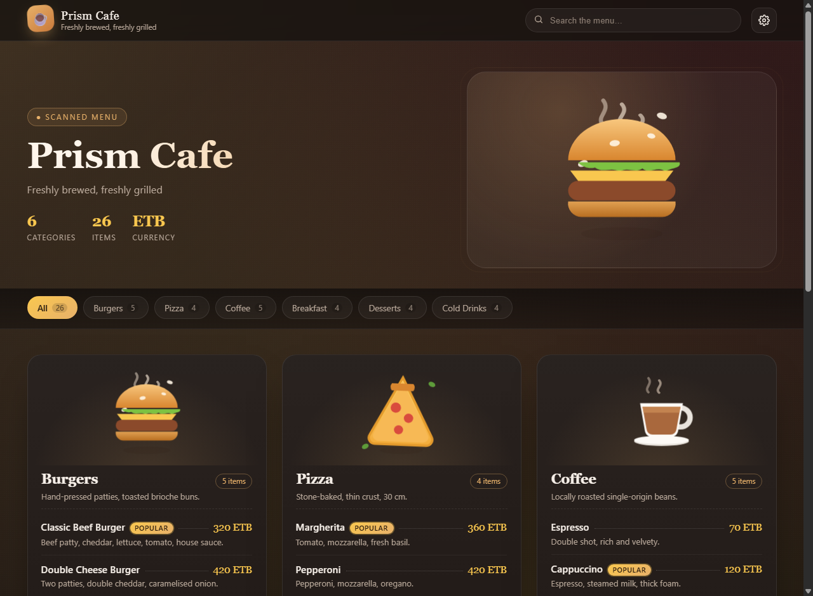
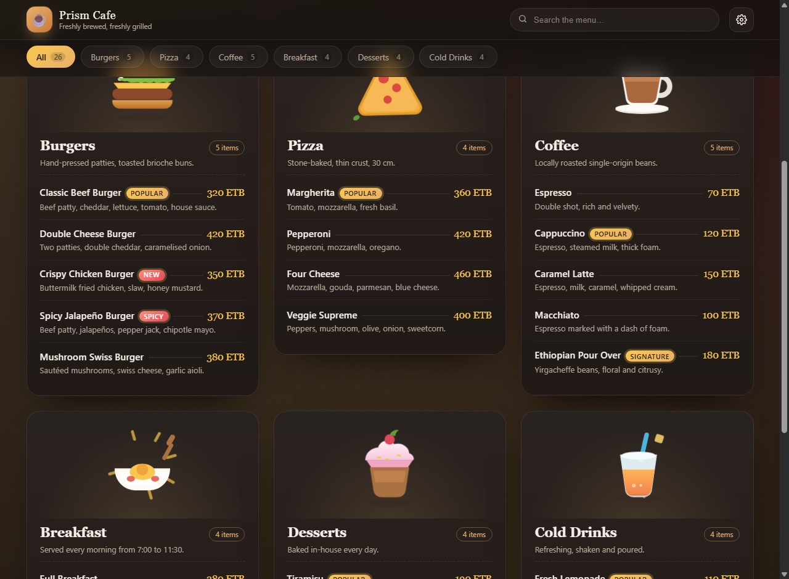
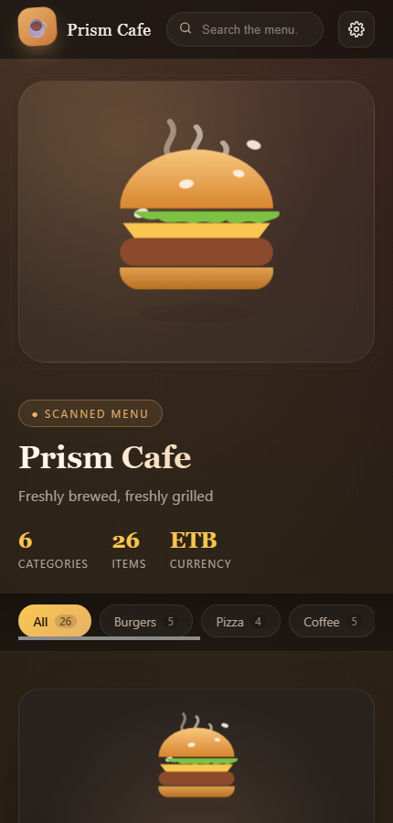
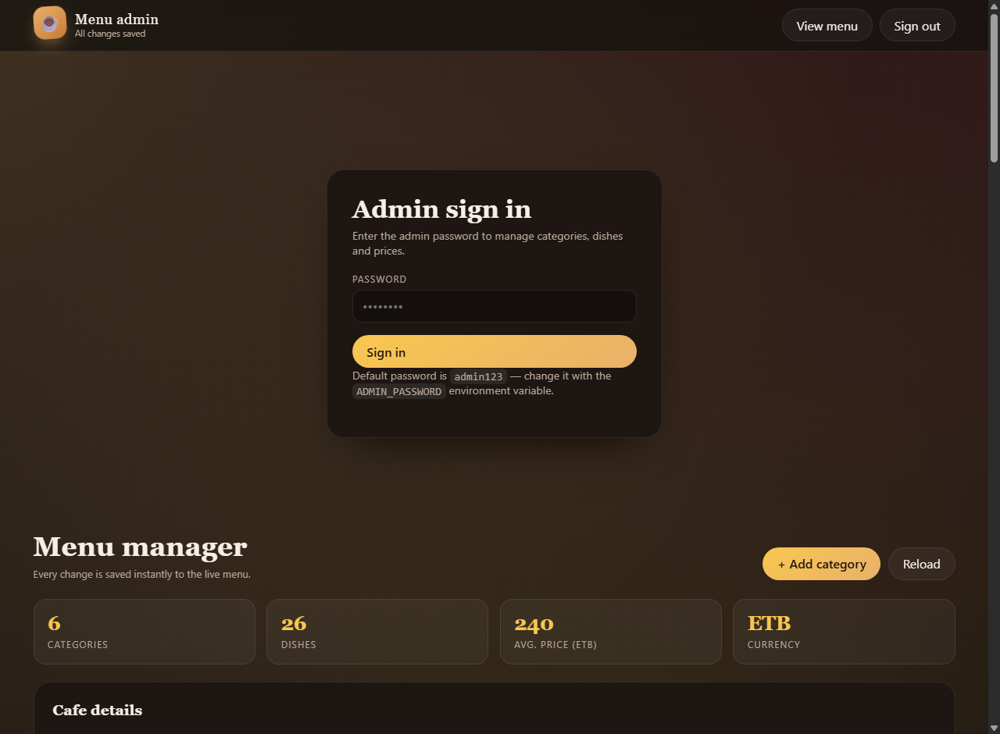
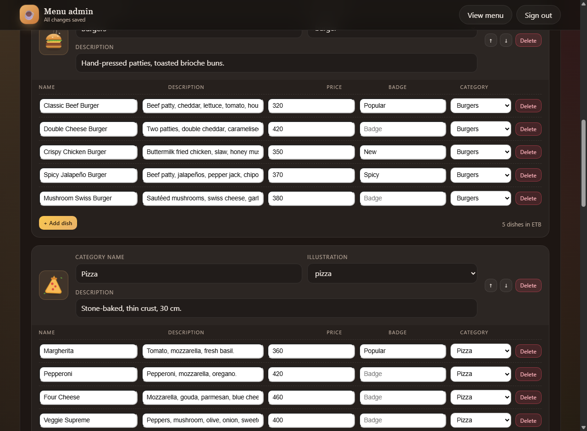

# ☕ Prism Cafe — Animated QR Menu

A beautiful, animated digital menu for a cafe that opens from a QR code, plus a
full admin dashboard to manage the menu live — no code editing, no redeploy.

Every category is a card with its own hand-drawn, animated SVG illustration on
top (a burger that bobs while steam rises, a pizza that tilts, a soda glass with
rising bubbles…) followed by that category's dish list.

| Menu (desktop) | Menu (scrolled) | Menu (mobile) |
| --- | --- | --- |
|  |  |  |

| Admin dashboard | Category & dish editor |
| --- | --- |
|  |  |

## Features

**Guest-facing animated menu (`/`)**

- **Animated category showcase cards** — each food category has an animated illustration on top (flame-grilled burger with rising steam & toasted sesame seeds, pizza with stretching cheese strings, steaming espresso latte, fizzy iced drinks with rising bubbles, strawberry glazed desserts with twinkling stars, sunny breakfast skillet with morning rays, pasta, and more).
- **Interactive Table Order Tray** — guests can tap `+` on any dish to add to their tray, review items and quantities, add special instructions, and send the order directly via **WhatsApp** or ring the **Service Bell / Call Waiter**!
- **Table detection & QR system** — recognizes `?table=5` from scanned QR codes, displays table indicator, and includes a live table QR generator modal with printable stand layout.
- **Synthesized Web Audio sound effects** — pleasant wooden click/pop feedback and crystal service bell chime (toggleable 🔊/🔇, zero external assets).
- **Guest WiFi bar** — shows WiFi network & password with 1-click clipboard copy.
- **Live search & dietary filters** — instant search across dishes, plus quick filter pills (`🔥 Popular`, `🌶️ Spicy`, `✨ New`, `⭐ Signature`).
- **Scroll-reveal & cursor 3D glow** — staggered animation on load, smooth 3D hover tilt and glow on cards.
- Respects `prefers-reduced-motion` and mobile-first responsive design.

**Admin dashboard controller (`/admin`)**

- Password sign-in (`admin123` default) with HMAC-signed session tokens.
- Add, rename, reorder, re-describe, and delete categories with animated illustration picker.
- Add, edit, move, badge (`Popular`, `Spicy`, `New`, `Signature`, `Veg`), and delete food dishes.
- **Table QR Code Studio** — generate and print table tent cards for any table number in seconds.
- **Cafe Operations** — manage Cafe Name, Tagline, Currency, WhatsApp Order Phone, and Guest WiFi credentials.
- Autosaves text edits instantly as you type (debounced) &mdash; the live QR menu updates in real time.
- Real-time statistics, live menu search filter, and one-click sample menu reset.

## Quick start

```bash
npm install
npm start            # http://localhost:3000
```

| URL | What it is |
| --- | --- |
| `http://localhost:3000/` | The QR menu guests see |
| `http://localhost:3000/admin` | The admin dashboard |
| `http://localhost:3000/qr.png?url=...` | PNG QR code for any URL |

Then open `/admin`, sign in with the default password `admin123` and start editing.

### Configuration

| Variable | Default | Purpose |
| --- | --- | --- |
| `PORT` | `3000` | Port the server listens on |
| `ADMIN_PASSWORD` | `admin123` | Password for the admin dashboard |
| `SESSION_SECRET` | random per boot | Secret used to sign admin session tokens |

```bash
ADMIN_PASSWORD="a-strong-password" SESSION_SECRET="some-long-random-string" npm start
```

## How the data works

The menu lives in `data/menu.json`, created from `server/seed.js` on first run.
The admin dashboard writes to it through the API, so the file on disk is always
the live menu. Delete the file (or press *Reset to sample menu*) to start over.

## API

| Method | Route | Auth | Description |
| --- | --- | --- | --- |
| `GET` | `/api/menu` | – | The full published menu |
| `GET` | `/api/health` | – | Health check |
| `GET` | `/qr.png?url=&size=` | – | PNG QR code |
| `POST` | `/api/admin/login` | – | Exchange the password for a session token |
| `GET` | `/api/admin/session` | ✔ | Validate the current token |
| `PUT` | `/api/admin/cafe` | ✔ | Update cafe name, tagline, currency, footer, logo |
| `POST` | `/api/admin/categories` | ✔ | Create a category |
| `PUT` | `/api/admin/categories/:id` | ✔ | Rename / re-describe / re-illustrate a category |
| `DELETE` | `/api/admin/categories/:id` | ✔ | Delete a category and its dishes |
| `POST` | `/api/admin/categories/reorder` | ✔ | Reorder categories (`{ order: [id, …] }`) |
| `POST` | `/api/admin/categories/:id/items` | ✔ | Add a dish |
| `PUT` | `/api/admin/items/:id` | ✔ | Edit a dish, or move it with `{ categoryId }` |
| `DELETE` | `/api/admin/items/:id` | ✔ | Delete a dish |
| `POST` | `/api/admin/reset` | ✔ | Restore the sample menu |

Authenticated routes expect `Authorization: Bearer <token>`.

```bash
curl -s -X POST localhost:3000/api/admin/login \
  -H 'Content-Type: application/json' \
  -d '{"password":"admin123"}'
```

## Project structure

```
cafe-qr-menu/
├── server/
│   ├── index.js      Express app: static files, public API, admin CRUD, QR codes
│   ├── store.js      JSON file store with atomic writes
│   ├── auth.js       Password check + HMAC session tokens
│   └── seed.js       The sample menu written on first run
├── public/
│   ├── index.html    The guest menu
│   ├── admin.html    The admin dashboard
│   ├── css/style.css Theme + the whole animation system
│   ├── css/admin.css Dashboard styles
│   └── js/
│       ├── icons.js  Animated SVG illustrations per category
│       ├── app.js    Menu rendering, search, chips, scroll reveals
│       └── admin.js  Login, autosave, modals, CRUD wiring
├── docs/             Screenshots used in this README
└── data/menu.json    Generated — the live menu
```

## Adding your own illustrations

`public/js/icons.js` maps an icon key to an SVG string. Animated parts use the
`.ill-*` classes defined in `public/css/style.css` (`ill-bob`, `ill-steam`,
`ill-tilt`, `ill-rays`, `ill-bubble`, `ill-pop`, `ill-sway`, `ill-sprinkle`,
`ill-fry`), with `ill-delay-1` / `ill-delay-2` to offset repeats. Add a new key
there and it automatically appears in the admin illustration picker.

## Deploying

The app is a single Node process serving static files, so any Node host works
(Render, Railway, Fly.io, a small VPS, Docker…). Set `PORT`, `ADMIN_PASSWORD`
and `SESSION_SECRET` in the environment, then point the QR code at your domain:

```
https://your-domain/qr.png?url=https://your-domain/
```

Print that PNG and put it on the tables — guests scan it and land on your live menu.

## Tech stack

Node.js + Express for the API, vanilla JavaScript/CSS/SVG on the front end
(no build step, no framework), `qrcode` for the printable QR image.

## License

MIT
